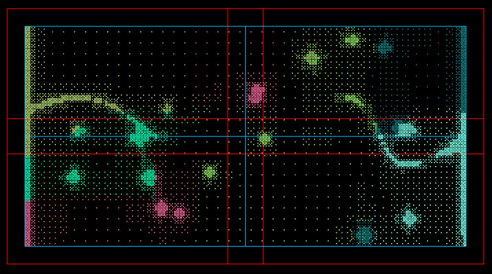

# redist

## Overview

`redist` converts the processor-local velocity files written by
[NPSAT](https://gwt.ucdavis.edu/research-tools-and-applications/npsat-engine)
into the two-dimensional processor partition expected by
[Ichnos](https://github.com/giorgk/ichnos).

NPSAT distributes its three-dimensional mesh with deal.II/p4est. That
distribution is suitable for solving the flow system, but a processor's cells
can occupy irregular or disconnected regions in the horizontal plane. Ichnos
instead uses regular two-dimensional subdomains for particle tracking. `redist`
reads every NPSAT processor file, assigns data to the requested horizontal
polygons, and writes one Ichnos input set per new MPI rank.



Two polygon sets define the new partition:

- **Actual domains** define which MPI rank owns a velocity point.
- **Expanded domains** define the larger area for which that rank stores
  velocity data. The overlap lets Ichnos continue interpolation near a
  subdomain boundary before handing a particle to another rank.

The redistribution is horizontal: polygon tests use only `x` and `y`; the full
three-dimensional coordinates and velocity values are retained.

## Running redist

Run one redist MPI rank for every polygon ID in the actual and expanded domain
files:

```powershell
mpiexec.exe -n <number-of-new-domains> redist.exe <input-file>
```

For example:

```powershell
cd Example_data
& "C:\Program Files\Microsoft MPI\Bin\mpiexec.exe" -n 4 ..\Debug\redist.exe example1_input.txt
```

The MPI rank is used as the new domain ID. Domain files should therefore use
contiguous IDs from `0` through `MPI-size - 1`, and both files should describe
the same set of IDs.

Paths in the input file are resolved from redist's current working directory.
All entries are whitespace-delimited, so paths and filename components cannot
contain spaces.

## Configuration file

The input file has exactly five logical lines:

```text
Nproc prefix leadingZeros suffix [useGraph [iter]] [inputFormat [outputFormat | outputSuffix [outputFormat]]] [outputWriteBatchSize outputWriteMaxAttempts outputWriteRetryDelaySeconds]
Ndata NprintData Col1 Col2 ...
Ndigit1 Ndigit2 ...
ActualDomain ExpandedDomain
NewPrefix
```

The brackets above indicate optional fields; do not type the brackets. When
specifying `inputFormat`, also specify `useGraph`. When `useGraph` is nonzero,
`iter` is required and comes before `inputFormat`. `outputFormat` can be
supplied directly after `inputFormat`, or after an explicit `outputSuffix`.
The three output-write controls are optional but, when supplied, must all be
present after an explicit `outputFormat`.

### Line 1: source files, graph mode, and input format

```text
Nproc prefix leadingZeros suffix [useGraph [iter]] [inputFormat [outputFormat | outputSuffix [outputFormat]]] [outputWriteBatchSize outputWriteMaxAttempts outputWriteRetryDelaySeconds]
```

| Option | Required | Meaning |
| --- | --- | --- |
| `Nproc` | Yes | Number of MPI ranks used by the original NPSAT flow simulation. redist reads source ranks `0` through `Nproc - 1`. This can differ from the MPI size used to run redist. |
| `prefix` | Yes | Source path and filename text before the zero-padded source rank. For the new NPSAT exporter this normally ends in `_4redist_`. |
| `leadingZeros` | Yes | Width of the zero-padded source-rank field. A value of `4` produces `0000`, `0001`, and so on. The same width is used for output rank names. |
| `suffix` | Yes | Source velocity suffix, such as `.vel` for ASCII or `.vel.bin` for binary. The velocity filename is `prefix + padded-rank + suffix`. |
| `useGraph` | No | `0` disables graph processing; any nonzero integer enables it. If omitted, graph processing is disabled for compatibility with old four-field files. |
| `iter` | Required when `useGraph != 0` | Number of cell-neighbor expansion passes used to build the overlap. `2` is a common choice. Do not supply it when graph processing is disabled. |
| `inputFormat` | No | `ascii`, `binary`, or `auto` (case-insensitive). The default is `auto`: a suffix ending in `.bin` selects binary; every other suffix selects ASCII. This controls only the source reader. |
| `outputSuffix` | No | Suffix for redistributed velocity files. It must appear before `outputFormat` when both are supplied. With ASCII output, the default reuses `suffix` and removes a final `.bin` from binary input. With binary output, the default reuses `suffix` and appends `.bin` if needed. An explicit suffix is used exactly as written. |
| `outputFormat` | No | `ascii` or `binary` (case-insensitive). The default is `ascii`, preserving legacy behavior. If this token immediately follows `inputFormat`, the suffix is derived automatically. Input and output formats are independent. |
| `outputWriteBatchSize` | No | Maximum number of redist MPI ranks allowed to write output simultaneously. The default is `1`. Values must be at least `1`. |
| `outputWriteMaxAttempts` | No | Maximum write-close-readback attempts for each output batch. The default is `3`. Values must be at least `1`. |
| `outputWriteRetryDelaySeconds` | No | Seconds all MPI ranks wait before retrying a failed output batch. The default is `10`; `0` disables the delay. |

Examples of valid first lines:

```text
# Legacy ASCII, no graph
4 example1_ 4 .vel

# Legacy ASCII with graph and two neighbor-expansion passes
6 output2/TuleRiver2_ 4 .vel 1 2

# New NPSAT ASCII export
8 output/model_4redist_ 4 .vel 1 2 ascii

# New NPSAT binary input; default ASCII output uses .vel
8 output/model_4redist_ 4 .vel.bin 1 2 binary

# Binary input selected from .bin with an explicit ASCII output suffix
8 output/model_4redist_ 4 .vel.bin 1 2 auto .ich

# Binary velocity input without graph processing
8 output/model_4redist_ 4 .vel.bin 0 binary

# Binary input and binary output; output suffix derives as .vel.bin
8 output/model_4redist_ 4 .vel.bin 1 2 binary binary

# Binary input/output with one writer, seven attempts, and a 10-second delay
128 output/model_4redist_ 4 .vel.bin 1 2 binary binary 1 7 10

# ASCII input, explicit binary output suffix, and binary output
8 output/model_4redist_ 4 .vel 1 2 ascii .ich.bin binary
```

The `#` descriptions in this example are explanatory only. Do not put them in
an actual configuration file.

For a network filesystem, start with `outputWriteBatchSize = 1`. Increasing it
can improve throughput, but also increases simultaneous data flushes and file
open/close operations. The setting controls only final output writing; all
redist ranks still participate in reading and redistribution.

When graph mode is enabled, source graph names are derived from `inputFormat`
independently of `suffix`:

- ASCII: `prefix + padded-rank + .grph`
- Binary: `prefix + padded-rank + .grph.bin`

### Line 2: available and selected data columns

```text
Ndata NprintData Col1 Col2 ...
```

| Option | Meaning |
| --- | --- |
| `Ndata` | Number of data values following `x y z` in each source velocity record. The optional cell ID used in graph mode is not included. |
| `NprintData` | Number of those data values to write. It must not exceed `Ndata`. |
| `Col1 Col2 ...` | Exactly `NprintData` one-based source-data indices, in the order they should appear in the output. Indices may be reordered or omitted. |

The current NPSAT `4redist` export exposes six logical data columns in both
ASCII and binary modes:

| Index | Value |
| ---: | --- |
| 1 | `vx` |
| 2 | `vy` |
| 3 | `vz` |
| 4 | original NPSAT source rank |
| 5 | cell diameter |
| 6 | horizontal-to-vertical cell-size ratio |

Binary NPSAT input always provides exactly these six columns, so `Ndata` must
be `6`. For example:

```text
6 5 5 6 1 2 3
```

This writes `diameter ratio vx vy vz`. The output processor column is inserted
automatically after `x y z`; it is not selected here. Column 4 is normally
omitted because it identifies the old NPSAT owner, while the inserted processor
column identifies the new Ichnos owner.

### Line 3: output precision

```text
Ndigit1 Ndigit2 ...
```

Provide exactly `NprintData` integers. Each value is the number of digits after
the decimal point for the corresponding selected ASCII output value. The order
matches the selected columns on line 2, not their original source order. This
line is still required for binary output, but binary values are stored as raw
64-bit doubles and are not rounded to these precisions.

For example, with `6 5 5 6 1 2 3` on line 2:

```text
2 2 6 6 6
```

the diameter and ratio use two decimal places, and the three velocity
components use six. ASCII coordinates are currently written in fixed notation
with three decimal places; that precision is not configurable. Binary
coordinates retain their full double precision.

### Line 4: actual and expanded domain files

```text
ActualDomain ExpandedDomain
```

- `ActualDomain` is the polygon file defining the owner of each point.
- `ExpandedDomain` is the polygon file defining all data retained by each rank,
  including overlap around its actual domain.

Both files use this ASCII layout:

```text
Npolygons
polygon_id_0 Nvertices_0
x_0 y_0
x_1 y_1
...
polygon_id_1 Nvertices_1
x_0 y_0
...
```

The expanded polygon for a rank should contain its actual polygon and the
desired overlap. Actual polygons should collectively cover every point that can
be selected. redist uses a strict point-within-polygon test, so a point lying
exactly on a polygon boundary is not considered inside; design shared
boundaries or overlaps accordingly.

### Line 5: output prefix

```text
NewPrefix
```

`NewPrefix` contains the output directory and filename text before the padded
new rank. redist does not create missing directories.

Velocity output names are:

```text
NewPrefix + padded-new-rank + outputSuffix
```

When graph mode is enabled, graph output names are selected by `outputFormat`:

```text
ASCII:  NewPrefix + padded-new-rank + .grph
Binary: NewPrefix + padded-new-rank + .grph.bin
```

## Source file formats

### ASCII velocity input

Without graph processing, each nonempty record must contain at least:

```text
x y z data_1 data_2 ... data_Ndata
```

Any remaining fields on that line, including a cell ID from an NPSAT export,
are ignored in no-graph mode.

With graph processing, the cell ID follows the selected data fields:

```text
x y z data_1 data_2 ... data_Ndata cell_id
```

For current NPSAT `4redist` output, this is:

```text
x y z vx vy vz source_rank diameter ratio cell_id
```

### ASCII graph input

Each nonempty graph record is:

```text
cell_center_x cell_center_y cell_center_z neighbor_count cell_id neighbor_id_1 ... neighbor_id_N
```

### Binary NPSAT input

Binary input is the version-1 format produced by the new NPSAT Ichnos exporter.
redist validates the file magic, format version, dimension, source rank, and
original processor count before reading records. It accepts velocity exports
with either one or eight points per cell and either coarse-face or fine-face
velocity calculation mode.

Use `.vel.bin` velocity files and the matching `.grph.bin` files. Input and
output encodings are independent: binary NPSAT input can be redistributed to
either ASCII or binary Ichnos files.

## Graph and no-graph processing

### Graph mode (`useGraph != 0`)

Each redist rank reads the graph files from all original NPSAT ranks. Cell
centers inside its actual polygon form the initial cell set; cells in the
expanded polygon form the available buffer. redist then adds graph neighbors
for `iter` passes, reads velocity points belonging to the selected cells, and
writes both a redistributed velocity file and a local graph file.

This is the recommended mode for current Ichnos cloud interpolation because it
preserves cell-to-cell and cell-to-velocity connectivity.

### No-graph mode (`useGraph == 0` or omitted)

Each redist rank reads all source velocity files and keeps points whose `x,y`
coordinates are inside its expanded polygon. It determines the point's owner
from the actual polygons and writes only a velocity file. No graph file is
read or produced, and `iter` is not used.

## Redistributed Ichnos output

`outputFormat` controls both the velocity encoding and, when graph mode is
enabled, the graph encoding. The two files of one rank always use the same
encoding.

### Verified and batched output

Final output is written in MPI-rank batches controlled by
`outputWriteBatchSize`. A rank explicitly flushes and closes its velocity file
and, in graph mode, its graph file. It then reopens the files and verifies their
complete contents before the batch can advance:

- ASCII records are compared line-by-line with the generated output.
- Binary velocity headers, source-column metadata, coordinates, owners, data
  values, record counts, and end-of-file position are checked.
- Binary graph headers, cell centers, neighbor IDs, velocity IDs, record
  counts, and end-of-file position are checked.

All ranks participate in a collective success check. If any writer fails, the
entire batch waits `outputWriteRetryDelaySeconds` and is rewritten, up to
`outputWriteMaxAttempts`. A permanent failure returns a nonzero program exit
status and prevents later batches from writing. File-open and close errors
include the operating-system `errno` number and message when available.

Successful files are reported only after readback verification, for example:

```text
    Rank 0 wrote and verified velocity file: output/model_0000.vel.bin after 1 attempt
    Rank 0 wrote and verified graph file: output/model_0000.grph.bin after 1 attempt
```

### ASCII output

Every velocity row is:

```text
x y z new_owner_rank selected_data_1 selected_data_2 ...
```

With the usual line-2 selection `6 5 5 6 1 2 3`, the row is:

```text
x y z new_owner_rank diameter ratio vx vy vz
```

In graph mode, every graph row is:

```text
cell_x cell_y cell_z neighbor_cell_count velocity_point_count neighbor_cell_indices... velocity_point_indices...
```

Cell and velocity indices are zero-based and local to that redistributed rank's
output files.

### Binary output, version 1

Binary output uses fixed-width integer fields and 64-bit `double` values. The
current x86/x64 implementation writes native little-endian byte order. Strings,
separators, and per-record padding are not written. The magic includes its
trailing null byte.

#### Velocity file

The velocity magic is the eight bytes `RDIVEL1\0`. The header is:

| Field | Type | Meaning |
| --- | --- | --- |
| magic | `char[8]` | `RDIVEL1\0` |
| version | `uint32` | `1` |
| dimension | `uint32` | `3` |
| output rank | `uint32` | New redist/Ichnos rank represented by this file |
| output MPI size | `uint32` | Number of ranks used to run redist |
| data-column count | `uint32` | `NprintData` |
| point count | `uint64` | Number of velocity records in the file |
| source column IDs | `uint32[NprintData]` | The one-based `Col1 Col2 ...` values from configuration line 2 |

Exactly `point count` records follow. Each record is:

| Field | Type |
| --- | --- |
| `x`, `y`, `z` | three `double` values |
| new owner rank | `int32` |
| selected data | `double[NprintData]` in configured output order |

The source-column metadata makes the common sequence `5 6 1 2 3`
self-describing as `diameter ratio vx vy vz`. Binary values retain full double
precision; line-3 decimal settings apply only to ASCII output.

#### Graph file

The graph magic is the eight bytes `RDIGRP1\0`. The header is:

| Field | Type | Meaning |
| --- | --- | --- |
| magic | `char[8]` | `RDIGRP1\0` |
| version | `uint32` | `1` |
| dimension | `uint32` | `3` |
| output rank | `uint32` | New redist/Ichnos rank represented by this file |
| output MPI size | `uint32` | Number of ranks used to run redist |
| cell count | `uint64` | Number of graph records |
| velocity-point count | `uint64` | Number of records in the matching binary velocity file |

Exactly `cell count` variable-length records follow. Each record is:

| Field | Type |
| --- | --- |
| cell-center `x`, `y`, `z` | three `double` values |
| neighbor count | `uint32` |
| cell velocity-point count | `uint32` |
| neighbor cell IDs | `uint64[neighbor count]` |
| velocity-point IDs | `uint64[cell velocity-point count]` |

Cell and velocity IDs are zero-based local indices. In binary graph mode,
points outside every actual polygon are excluded before IDs and counts are
assigned, so all graph velocity references address records that exist in the
matching velocity file.

## Complete examples

### Legacy ASCII without graph files

```text
4 example1_ 4 .vel
6 5 5 6 1 2 3
2 2 6 6 6
example1_actual_dom.dat example1_expanded_dom.dat
example1_new_
```

This preserves the original four-field first line and therefore disables graph
processing.

### Legacy ASCII with graph files

```text
6 output2/TuleRiver2_ 4 .vel 1 2
6 5 5 6 1 2 3
2 2 6 6 6
Tule_actual_dom.dat Tule_extended_dom.dat
output2/TuleRiver2new_
```

### New NPSAT binary input and binary Ichnos output with graph files

```text
8 output/model_4redist_ 4 .vel.bin 1 2 binary binary
6 5 5 6 1 2 3
2 2 6 6 6
domains/model_actual.dat domains/model_expanded.dat
ichnos/model_
```

For source rank 0, this reads:

```text
output/model_4redist_0000.vel.bin
output/model_4redist_0000.grph.bin
```

For new rank 0, it writes binary files:

```text
ichnos/model_0000.vel.bin
ichnos/model_0000.grph.bin
```

## Compatibility and practical notes

- Existing four-field no-graph and six-field graph configuration lines remain
  valid.
- Both previous NPSAT ASCII files and current NPSAT ASCII/binary `4redist`
  files are supported.
- Redistributed Ichnos velocity files can be ASCII or binary. Graph output uses
  the same encoding as the velocity output.
- ASCII remains the default output format, so existing configuration files and
  downstream Ichnos workflows retain their previous behavior.
- Ichnos must add readers for the `RDIVEL1` and `RDIGRP1` version-1 formats
  before it can consume binary redist output.
- All source files must use the configured rank padding and must exist for
  every source rank from `0` through `Nproc - 1`.
- Graph mode requires matching velocity and graph files from the same NPSAT
  export.
- The new NPSAT Ichnos export is intended for steady-state solutions.
- Because polygon membership is two-dimensional, all elevations at a selected
  horizontal location are assigned using the same actual/expanded domains.
- A message saying a point is not in any processor polygon indicates a gap or
  boundary problem in the actual-domain definitions and should be corrected
  before using the output in Ichnos.
